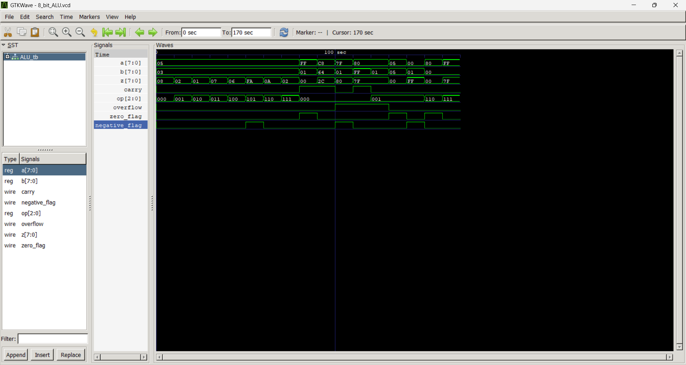

8-Bit ALU in Verilog

An 8-bit Arithmetic Logic Unit (ALU) designed using Verilog HDL. It performs arithmetic, logical, and shift operations and generates status flags based on the result.

Operations

The ALU supports eight operations selected using the 3-bit input op:

000 — Addition (a + b)

001 — Subtraction (a - b)

010 — Bitwise AND

011 — Bitwise OR

100 — Bitwise XOR

101 — Bitwise NOT (~a)

110 — Left Shift (a << 1)

111 — Right Shift (a >> 1)

Status Flags

Carry: Indicates carry-out during addition.

Zero: Set when the result is zero.

Overflow: Indicates signed overflow during addition or subtraction.

Negative: Copies the most significant bit of the result.

Testing

The testbench checks all eight operations, including carry-out, signed overflow, zero and negative results, and shift boundary cases.

Tools

Verilog HDL · Icarus Verilog · GTKWave

Compile the design and testbench:

iverilog -o alu_sim 8_bit_ALU.v ALU_tb.v

Run the simulation:

vvp alu_sim

Open the waveform:

gtkwave 8_bit_ALU.vcd

Waveform
## Waveform

Learning Outcomes

Practised combinational logic design, Verilog case statements, bitwise operations, status flag generation, and simulation-based verification.
